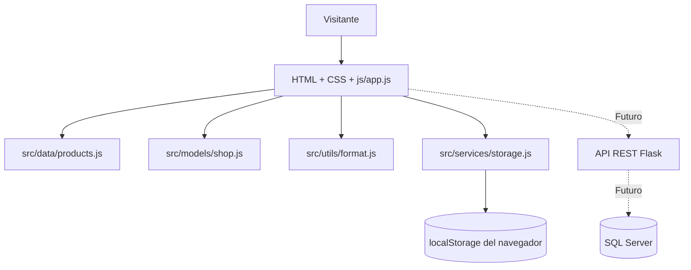

# Arquitectura de Fase II

## Contexto
Joyería J-C continúa el prototipo de Fase I. Se eligió conservar el stack HTML5, CSS3 y JavaScript nativo para evitar una migración innecesaria y desplegar en alojamiento estático.

## Diagrama de componentes

## Responsabilidades
- `index.html`: estructura semántica, formularios, diálogos y navegación.
- `css/styles.css`: identidad visual, diseño responsive, estados, animaciones y accesibilidad.
- `js/app.js`: eventos y presentación; integra componentes del DOM y el modelo.
- `src/data/products.js`: catálogo y existencias de demostración.
- `src/models/shop.js`: filtros, reglas de carrito, validaciones de pedidos y asesoría.
- `src/services/storage.js`: persistencia tolerante a errores en localStorage.
- `src/utils/format.js`: formato COP, fecha local y escape para HTML.
- `tests/`: pruebas automatizadas de reglas y persistencia.

## Modelo de datos local
`cart: [{id,qty}]`, `favorites: [id]`, `orders: [{id,createdAt,status,subtotal,items}]`, `appointments: [{id,date,time,type}]`. **El nombre y correo ingresados no se almacenan.**

## Límites de seguridad
No hay autenticación, autorización, disponibilidad real, pago, servicio de confirmación, correo, inventario sincronizado ni gestión multiusuario. Los datos pueden alterarse, borrarse o perderse con el navegador. Ningún dato del prototipo debe tratarse como orden comercial. La app no sustituye un backend transaccional.

## Estrategia siguiente fase
Backend Flask con recursos REST para productos, reservas, clientes y pedidos; SQL Server con migraciones; identidades/roles de cliente-administrador; validación de entrada del servidor; protección CSRF/sesiones según método de autenticación; transacciones con control de concurrencia de inventario; auditoría y observabilidad. Integrar pagos solo mediante proveedor certificado y sin almacenar datos sensibles de tarjeta.
